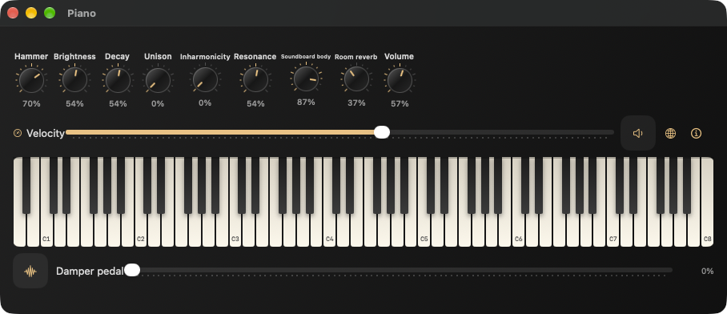
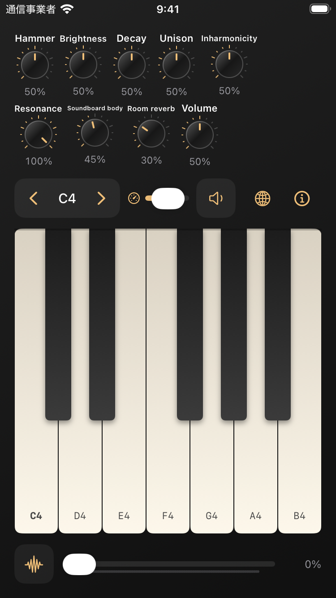
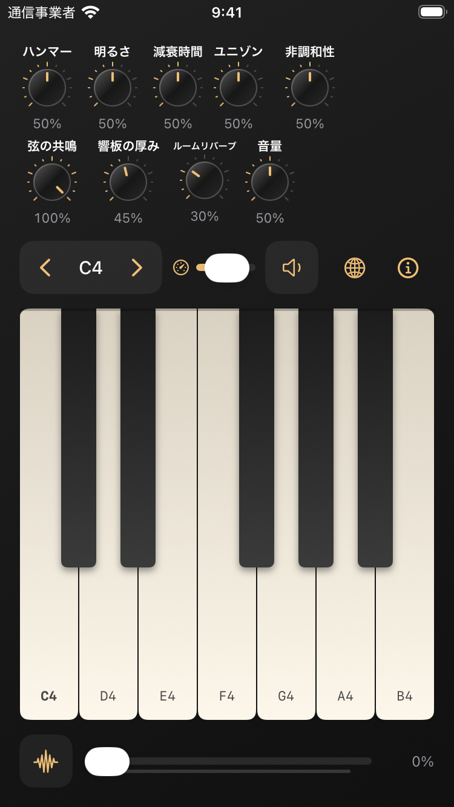
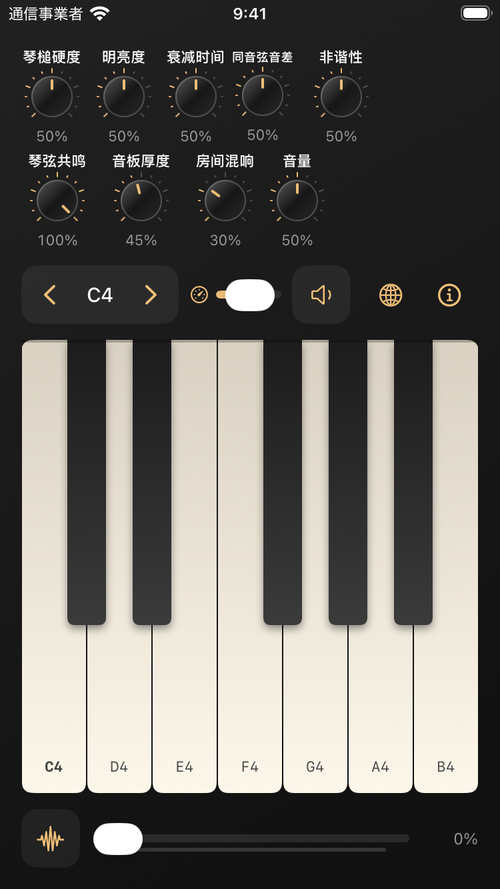

# Piano

Piano is an 88-key physical-modeling instrument for macOS, iOS, and iPadOS. It runs as a standalone SwiftUI app or as an AUv3 instrument in a compatible host.

## Screenshots



| English | 日本語 | 简体中文 |
| :---: | :---: | :---: |
|  |  |  |

## Build and run

Piano requires macOS 15 or later, or iOS and iPadOS 18 or later. To build, install Xcode and Rust through rustup. The F1 source and calibration data are included in [NativeEngine/F1](NativeEngine/F1).

1. Install the Rust targets for the platforms you plan to build.

   | Build destination | Rust target |
   | --- | --- |
   | Mac, Apple silicon | `aarch64-apple-darwin` |
   | Mac, Intel | `x86_64-apple-darwin` |
   | iPhone or iPad device | `aarch64-apple-ios` |
   | Simulator on Apple silicon | `aarch64-apple-ios-sim` |
   | Simulator on Intel | `x86_64-apple-ios` |

   For example, on an Apple silicon Mac, run the following to add iPhone and iPad build support:

   ```sh
   rustup target add aarch64-apple-ios aarch64-apple-ios-sim
   ```

2. Open `Piano.xcodeproj`. Select **Piano-macOS** for Mac or **Piano** for iPhone and iPad. Xcode builds and statically links the Rust audio engine.
3. To run on a physical iPhone or iPad, select your development team under **Signing & Capabilities** for both the app and its AUv3 extension.

## Play

- **Keyboard:** Mac displays all 88 keys, from A0 to C8. Click or drag across them to play. On iPhone and iPad, use multitouch and the arrows to change octaves. The upper slider sets hammer velocity for on-screen notes.
- **Damper pedal:** The slider below the keys sets pedal travel from 0% to 100%. Its waveform button switches between fully released and fully depressed. Partial travel changes both note decay and sympathetic resonance.
- **Soft pedal:** The speaker button above the keys engages una corda on the next notes. It models softer felt contact and directly strikes two strings on three-string notes. The remaining string can resonate through the bridge.
- **Sound controls:** The rotary knobs at the top of the instrument control the sound. Drag a knob vertically to adjust it, or double-click or double-tap it to restore its default. The app saves your settings.
- **Languages:** Use the globe menu to choose English, Japanese, Simplified Chinese, or the system default.

## Sound parameters

| Control | What it changes |
| --- | --- |
| Hammer | Felt stiffness at the hammer–string contact |
| Brightness | Level of upper frequencies |
| Decay | Loss in the string loop and how long notes ring |
| Unison | Tuning spread between strings struck by the same key |
| Inharmonicity | String stiffness and the spacing of upper partials |
| Resonance | Sympathetic ringing of other strings |
| Soundboard body | Low-mid radiation from the soundboard |
| Room reverb | Reflections and decay from the modeled room |
| Volume | Output level |

Unison and inharmonicity have three settings (0%, 50%, and 100%). New strikes use the selected string design. Other settings have a continuous range in AUv3 and 1% steps in the app.

## MIDI and AUv3

The standalone app automatically connects to available CoreMIDI sources. It responds to note velocity, continuous damper position (CC64), and the soft pedal (CC67).

The app embeds the **Piano: Physical Modeling F1** AUv3 instrument. On Mac, launch `Piano.app` once, then select the instrument on a software instrument track in an AUv3-compatible DAW. On iPhone and iPad, select it in an AUv3-compatible host. The plug-in supports mono or stereo output at 44.1–96 kHz and exposes the same nine sound controls to the host.

On Mac you can validate the registered instrument with:

```sh
auval -v aumu PF01 LPno
```

## Audio engine

Piano includes the Rust DSP and calibration data from Physical Modeling Piano F1 by Yoshiyuki Koyanagi (@moutend), based on upstream commit `15f0f76`. [Upstream source](https://github.com/moutend/physical-modeling-piano-f1/tree/15f0f768c8c737563285d08383b635eb588b7589) · [MIT license](NativeEngine/F1/LICENSE)

The standalone app renders stereo through AVAudioEngine at 44.1–48 kHz, depending on the audio route.

| Notes | Strings struck per key |
| --- | --- |
| A0–G♯1 | One wound string, with two vibration polarizations |
| A1–G♯2 | Two strings |
| A2–C8 | Three strings |

Each string has its own waveguide. Small tuning differences produce beating, and the bridge couples the strings to the soundboard and to one another. Piano adjusts unison spread and bridge coupling to bring out these variations. The soundboard body control reinforces the board's low-mid radiation independently of room reverb.

The high register is voiced for a stronger tonal core, with longer string aftersound and quieter action noise. In the first 96 ms, softer strikes reduce the upper partials of the direct string radiation more strongly, allowing the existing soundboard response to contribute more to the attack. Upper partials also decay faster in the treble string loops. Felt contact damps the upper partials of a string more strongly as its damper closes. The top 18 notes (G6–C8) have no dampers and decay naturally after release. These strings can also resonate sympathetically while playing other notes.

## Roadmap

- 🟢 [Done] F1 audio engine, 88-key range, half-pedaling, soft pedal, and room and soundboard controls
- 🟢 [Done] Mac and iOS apps, external MIDI input, and AUv3
- 🟠 [Next] Standard MIDI file import and playback
- ⭕️ [Pending] Physical MIDI hardware, additional DAW hosts, and on-device iPhone and iPad latency and listening tests
